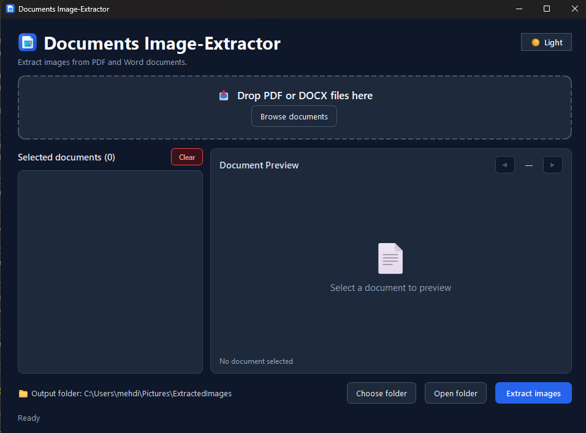

# Documents Image-Extractor 🖼️📄

<p align="center">
  
</p>

<p align="center">
  <strong>A modern, cross-platform desktop application to preview and extract high-resolution images from PDF and Word (.docx) documents.</strong>
</p>

<p align="center">
  
  
  
  
  
</p>

<p align="center">
  
</p>

---

## ✨ Features

- 📑 **PDF & Word Support**: Extract embedded images from `.pdf` and `.docx` files effortlessly.
- 👁️ **Live Document Preview**:
  - **PDF Preview**: Crisp, high-resolution page rendering with interactive pagination (`◀ Page X of Y ▶`).
  - **Word Preview**: Inspect and browse embedded images (`◀ Image X of Y ▶`) or view formatted document summaries and metadata.
- 📂 **Instant Folder Reveal**: Automatically opens Windows File Explorer directly to the folder containing your extracted images as soon as extraction finishes.
- 🌙 **Dark & Light Mode**: Sleek, eye-friendly Dark Theme by default, with an instant one-click toggle to Light Mode.
- 📥 **Drag-and-Drop Interface**: Drop files directly onto the app or browse through the file selector.
- 🗂️ **Batch Processing**: Process multiple files simultaneously, with images neatly organized into subfolders per document without overwriting duplicates.
- 📦 **Zero Installation Required**: Download the pre-built executable from Releases and run immediately without needing Python installed.

---

## 🚀 Download & Quick Start (No Python Required)

For Windows users who just want to use the application:

1. Go to the [**Releases**](https://github.com/MehdiD0/Documents-Image-Extractor/releases) section.
2. Download the latest `Documents-Image-Extractor.exe`.
3. Double-click the `.exe` to launch and start extracting images!

---

## 🛠️ Running from Source (Developers)

If you'd like to run or modify the source code:

### 1. Prerequisites
- Python 3.10, 3.11, 3.12, or 3.13 installed.
- Git installed.

### 2. Clone the Repository
```bash
git clone https://github.com/MehdiD0/Documents-Image-Extractor.git
cd Documents-Image-Extractor
```

### 3. Create a Virtual Environment
```bash
# Windows
python -m venv .venv
.venv\Scripts\activate

# Linux / macOS
python3 -m venv .venv
source .venv/bin/activate
```

### 4. Install Dependencies
```bash
pip install -r requirements.txt
```

### 5. Launch the Application
```bash
python main.py
```

---

## 🔨 Building the Executable (.exe)

You can build a standalone single-file executable using **PyInstaller**:

```bash
# 1. Install PyInstaller
pip install pyinstaller

# 2. Build single-file executable with embedded icon
pyinstaller --noconsole --onefile --icon=assets/icon.ico --name="Documents-Image-Extractor" --add-data "assets;assets" main.py
```

The compiled binary will be placed inside the `dist/` directory:
- `dist/Documents-Image-Extractor.exe`

---

## 🌐 Multi-Platform Releases (Windows, Linux, macOS)

This repository includes an automated **GitHub Actions CI/CD pipeline** (`.github/workflows/release.yml`). 

Whenever you publish a Git tag (e.g. `v1.0.0`):
1. GitHub automatically spins up **Windows**, **Ubuntu Linux**, and **macOS** runners in the cloud.
2. It compiles native standalone binaries for each platform.
3. It attaches all binaries (`.exe`, Linux binary, `.zip` for macOS) directly to your GitHub Release!

---

## 📂 Project Structure

```
DocImageExtractor/
├── .github/
│   └── workflows/
│       └── release.yml          # Automated multi-platform GitHub release pipeline
├── assets/
│   ├── icon.png                 # Application logo (PNG)
│   └── icon.ico                 # Multi-resolution Windows icon (ICO)
├── extractors/
│   ├── __init__.py
│   ├── pdf_extractor.py         # PyMuPDF-based image extraction
│   └── word_extractor.py        # DOCX XML & media extraction
├── tests/
│   └── test_preview.py          # Automated GUI & preview test suite
├── .gitignore                   # Excludes build/dist/.venv from git history
├── LICENSE                      # MIT License
├── main.py                      # Main PySide6 application & UI logic
├── requirements.txt             # Project dependencies
└── README.md                    # Project documentation
```

---

## 📄 License

This project is licensed under the **MIT License** - see the [LICENSE](LICENSE) file for details.
